# TongKas

Aplikasi pencatat keuangan sederhana untuk UMKM, dibangun sebagai aplikasi multi-tier
(Flask + PostgreSQL + Redis) yang seluruhnya berjalan di Docker Compose.

Projek UTS Cloud Services, Semester 5.

## Latar Belakang dan Alasan Projek

[Tulis dengan kata-kata Anda: masalah UMKM yang tidak mencatat keuangan, mengapa memilih
projek ini, dan kaitannya dengan peran karier yang Anda tuju.]

## Fitur

- Catat pemasukan dan pengeluaran dengan kategori
- Ringkasan masuk, keluar, dan laba otomatis
- Filter per bulan, hapus transaksi, dan export CSV
- Cache Redis untuk `GET /transactions` (header `X-Cache: HIT/MISS`)

## Arsitektur

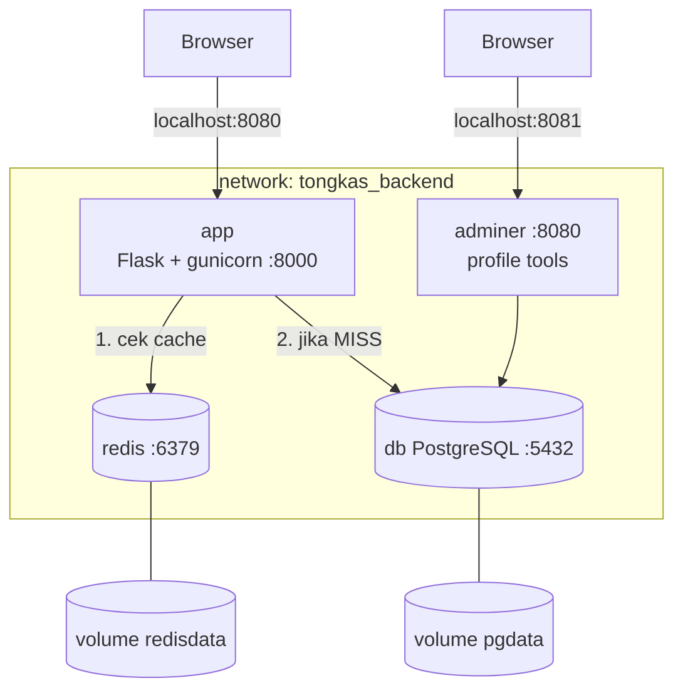

| Container | Image | Port host | Volume | Healthcheck |
|---|---|---|---|---|
| app | build lokal (multi-stage) | 8080 | - | - |
| db | postgres:16.4-alpine | tidak dibuka | pgdata | pg_isready |
| redis | redis:7.4-alpine | tidak dibuka | redisdata | redis-cli ping |
| adminer (profile tools) | adminer:4.8.1 | 8081 | - | - |

## Cara Menjalankan

Prasyarat: Docker Desktop.

```bash
git clone https://github.com/<username>/tongkas.git
cd tongkas
cp .env.example .env      # Windows CMD/PowerShell: copy .env.example .env
docker compose up -d --build
```

Buka http://localhost:8080

Opsional, Adminer (profile `tools`):

```bash
docker compose --profile tools up -d
```

Buka http://localhost:8081 (System: PostgreSQL, Server: `db`, user dan password sesuai `.env`).

Menghentikan: `docker compose down` (data tetap ada) atau `docker compose down -v` (data dihapus).

## Endpoint

| Method | Path | Keterangan | Status |
|---|---|---|---|
| GET | /health | cek aplikasi, database, dan cache | 200 / 503 |
| GET | /transactions | daftar dan ringkasan (`?month=YYYY-MM`) | 200 / 400 |
| POST | /transactions | tambah transaksi | 201 / 400 |
| DELETE | /transactions/{id} | hapus transaksi | 204 / 404 |
| GET | /export.csv | unduh CSV | 200 |

## Screenshot

## Screenshot

### Bagian b: Dockerfile
Ukuran image:
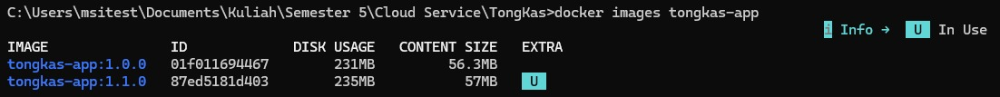

Ukuran image dan layer (`docker history`) yang membuktikan multi-stage build:
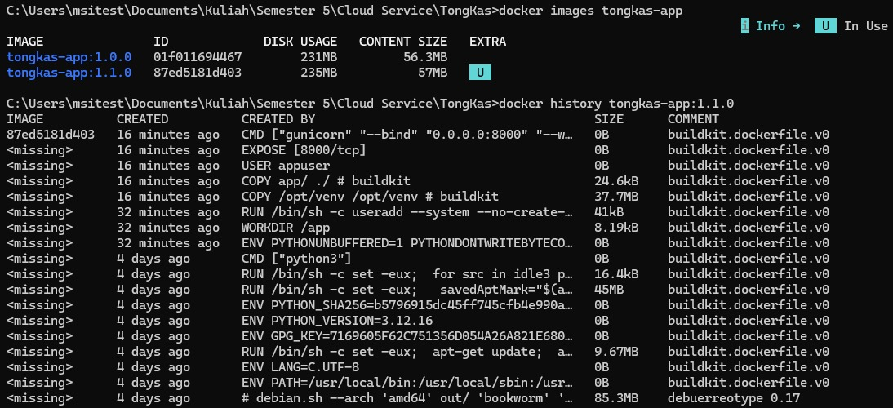

### Bagian c: Docker Compose
Service berjalan, db dan redis `healthy`:
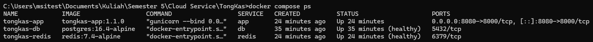

Profile `tools` (Adminer):
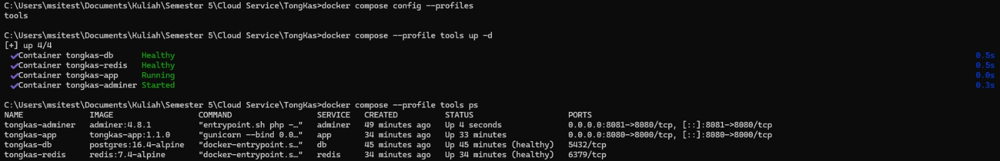

`.env` diabaikan Git:
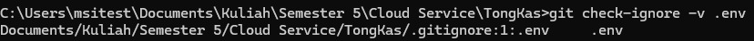

### Bagian d: Bukti berjalan di localhost
d(2) Uji endpoint, health `200` dan POST `201`:
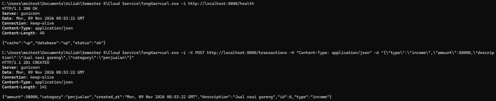

d(2) Cache `MISS` lalu `HIT`, dan validasi `400`:
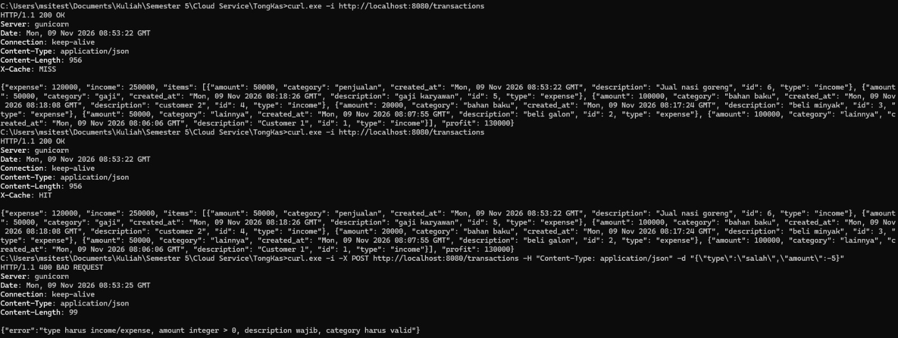

d(3) Persistensi, data sebelum `down`:
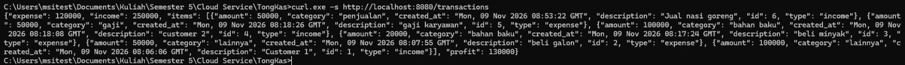

d(3) `docker compose down` lalu `up -d` (volume tetap ada):
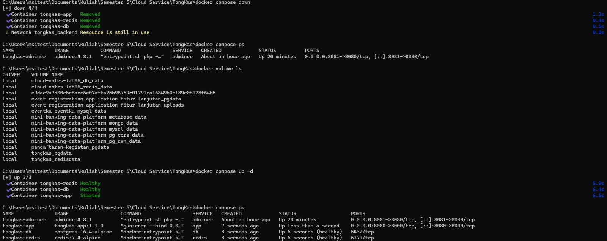

d(3) Data masih ada setelah `up`:
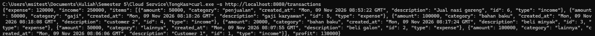

d(3) `docker compose down -v` (volume dihapus, data hilang):
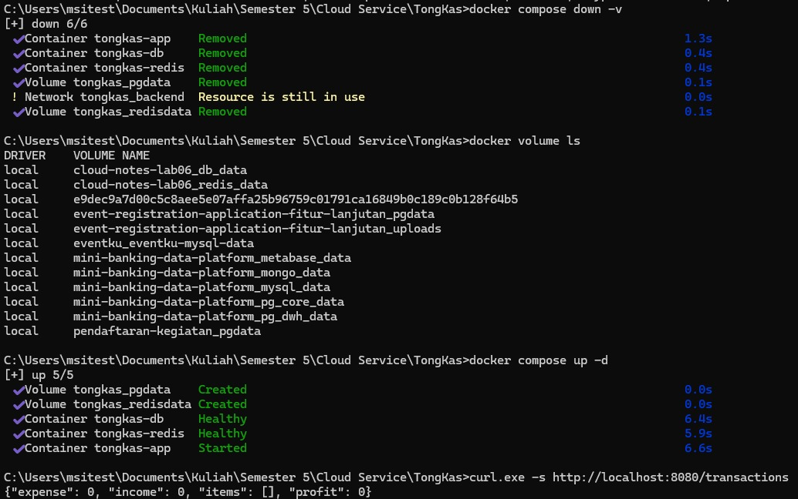

Catatan: pesan `Network tongkas_backend Resource is still in use` muncul karena container
Adminer (profile `tools`) masih terhubung ke network yang sama. Itu bukan error aplikasi.

### Tampilan aplikasi
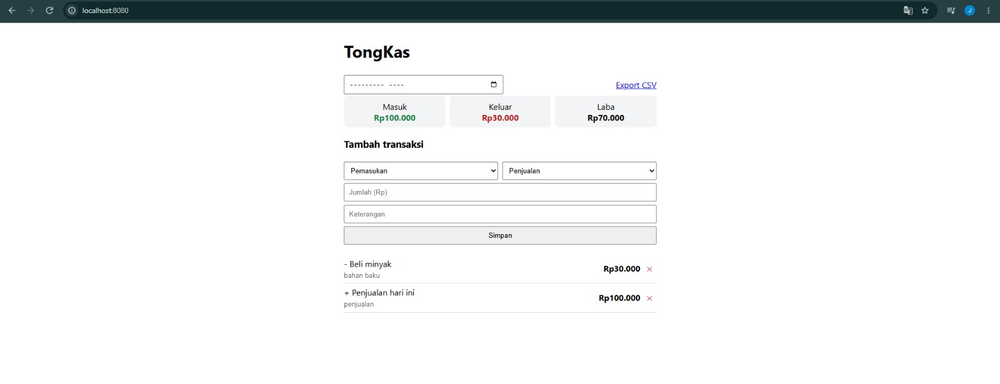
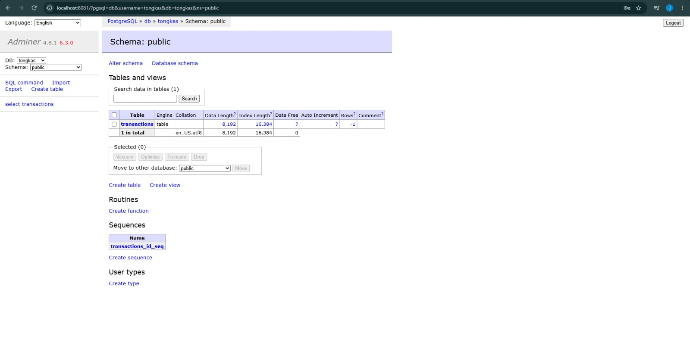

## Tautan

- Video demo: [isi setelah diunggah]
- Artikel: [isi setelah terbit]

## AI Usage Declaration

Saya menggunakan Claude (Anthropic) sebagai asisten untuk [sesuaikan: menyusun kerangka kode,
meninjau Dockerfile dan docker-compose, menyusun draf dokumentasi]. Saya menjalankan, menguji,
dan memahami seluruh kode, serta menulis narasi video dan artikel dengan kata-kata sendiri.